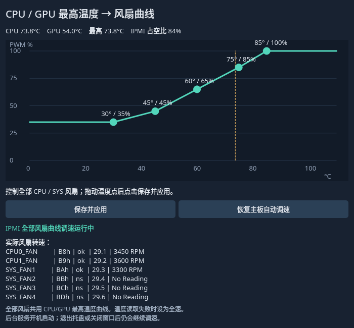

# Wayland IPMI Fan Control

通过本机 IPMI 按 **CPU / GPU 最高温度**调整全部主板风扇，提供托盘、浮动曲线编辑窗口和 KDE 应用菜单入口。

已在 **Arch Linux、Hyprland、GIGABYTE MZ72-HB0、BMC 12.50.09** 上验证。它使用这块主板的 OEM IPMI 命令，并非通用主板风扇控制器。KDE 应用入口已注册；完整 Plasma 会话未单独验证。



## 功能

- 每五秒读取 CPU 与 GPU 温度，取最高温度计算占空比。
- 五个可拖动的温度点，线性插值，保存并立即应用。
- 全部 CPU 和 SYS 风扇使用同一条曲线。
- 升速立即执行；降速每十秒最多降低五个百分点。
- 最高温度达到 90°C，或已监测的温度传感器丢失时，尝试设置最高档。
- 显示实际风扇 RPM；每十秒请求更新一次，原厂传感器仍可能有缓存延迟。
- 系统后台开机自启，托盘随图形会话启动。关闭窗口或退出托盘后，后台继续调速。
- 使用 `/dev/ipmi0`，不需要 BMC 网页、管理网络或 BMC 账号密码。

## 硬件验证范围

这块 MZ72-HB0 的风扇 SDR ID 为：

| 风扇 | ID |
|---|---|
| CPU0_FAN | `0xb8` |
| CPU1_FAN | `0xb9` |
| SYS_FAN1–4 | `0xba`–`0xbd` |

程序向以上 ID 逐一下发相同 PWM，不提供独立风扇曲线。这版固件的 `0xff` 全局 FanID 没有稳定控制 CPU 风扇，因此未使用该选择器。

### 最高档兼容处理

在本机测试中，PWM 原始值 `0xff`（100%）使 CPU 风扇降至约 3300–3600 RPM，而 `0xfc`（约 99%）可让两颗 CPU 风扇均达到约 6600 RPM。因此程序将软件最高档限制为 `0xfc`，故障保护也使用这个值。**界面 100% 表示软件最高档，实际发送的硬件占空比约为 99%。**

| 测试占空比 | CPU0_FAN | CPU1_FAN | SYS_FAN1 |
|---|---:|---:|---:|
| 80% | 约 5550 RPM | 约 5700 RPM | 约 3000 RPM |
| 99% | 约 6600 RPM | 约 6600 RPM | 约 3300 RPM |

这是当前风扇、接线和固件组合的实测结果；不是其他硬件的转速保证。未连接的 SYS_FAN2–4 显示 `No Reading`。

## 安装

依赖 Linux、systemd、Python 3.12+、`ipmitool`、`lm_sensors`、可工作的 NVIDIA 驱动和 `nvidia-smi`。当前温度读取要求 NVIDIA GPU 温度可用；其他 GPU 的 hwmon 温度会一并计入，但纯 AMD 配置尚未适配。

Arch Linux 安装基础依赖：

```sh
sudo pacman -S --needed python uv ipmitool lm_sensors
```

确认本机 IPMI 和温度可读：

```sh
sudo ipmitool -I open mc info
sudo ipmitool -I open sdr type fan
sensors
nvidia-smi --query-gpu=name,temperature.gpu --format=csv,noheader
```

安装界面依赖和服务：

```sh
git clone git@github.com:cyrus-xc/wayland-ipmi-fan-control.git
cd wayland-ipmi-fan-control
uv venv --python 3.12
uv pip install --python .venv/bin/python -r requirements.txt
sudo ./install-ipmi.sh
./install-desktop.sh
```

`install-ipmi.sh` 检查主板型号，将后台程序复制到 root 拥有的目录，并立即启用曲线调速。默认授权调用 sudo 的桌面用户；直接以 root 安装时默认 UID 为 1000。不会安装宽泛的 sudo 免密规则。

`install-desktop.sh` 请以普通桌面用户运行；它注册应用入口、风扇图标和托盘用户服务。安装后保留仓库和 `.venv`，托盘启动器会使用这个目录。安装路径支持空格，不支持引号、反斜杠、`$`、`%`、反引号或换行。

## 使用

在应用菜单搜索“风扇控制”，或执行：

```sh
./run.sh
```

点击托盘打开窗口，拖动温度点，再点击“保存并应用”。窗口使用 Qt 浮动工具窗口；对 Hyprland 0.57 的 Lua dispatcher 另作了浮动适配，其他合成器的置顶行为可能不同。

默认曲线：30°C/35%、45°C/45%、60°C/65%、75°C/85%、85°C/100%。软件最低占空比为 30%，仍需根据实际风扇的最低可靠转速调整。

点击“恢复主板自动调速”会发送 OEM 恢复命令并持久停用曲线控制；下次开机仍保持停用。再次“保存并应用”即可启用。恢复命令成功不代表原厂策略已正确配置，应观察实际 RPM。

## 服务与配置

| 项目 | 位置或名称 |
|---|---|
| 系统后台 | `gigabyte-ipmi-fan-control.service` |
| 托盘用户服务 | `gigabyte-fan-control.service` |
| 后台生效配置 | `/var/lib/gigabyte-fan-control/config.json` |
| 用户曲线草稿 | `~/.config/gigabyte-fan-control/config.json` |
| root 程序 | `/usr/local/lib/gigabyte-fan-control/` |
| 本机控制 socket | `/run/gigabyte-fan-control/control.sock` |

窗口启动时读取后台生效曲线。控制 socket 检查调用者 UID，只接受状态查询、曲线更新和恢复自动三种操作。

```sh
systemctl status gigabyte-ipmi-fan-control.service
journalctl -u gigabyte-ipmi-fan-control.service
systemctl --user status gigabyte-fan-control.service
```

更新代码后执行 `sudo ./update-ipmi.sh` 更新后台，再执行 `systemctl --user restart gigabyte-fan-control.service` 重启托盘。

后台异常退出由 systemd 重启；可处理的后台退出会尝试发送最高档命令。IPMI 故障、强制杀死或系统故障时无法保证保护命令成功，界面中的命令占空比不能替代实际 RPM 验证。

## 测试

```sh
.venv/bin/python -m unittest -v test_core.py test_ipmi.py
```

测试不写硬件，覆盖曲线插值、参数限制、风扇 ID、最高档固件兼容、停用状态及温度异常保护。上面的 RPM 表来自额外的硬件测试。

## 停用与卸载

先在窗口点击“恢复主板自动调速”，确认实际风扇转速正常，再停止服务：

```sh
systemctl --user disable --now gigabyte-fan-control.service
sudo systemctl disable --now gigabyte-ipmi-fan-control.service
```

随后可删除安装的 service、应用入口、图标、程序和配置文件。若未先停用曲线，后台正常退出时会尝试让风扇保持最高档。
